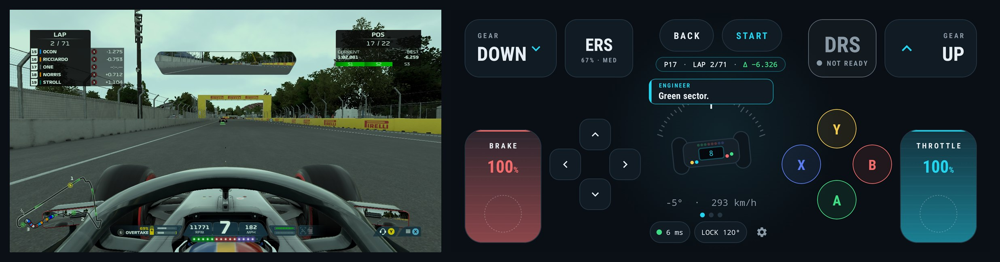
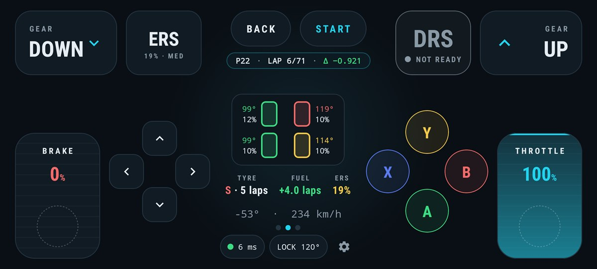
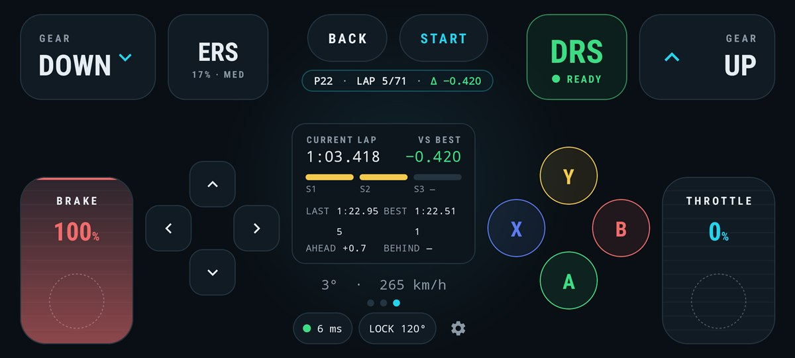
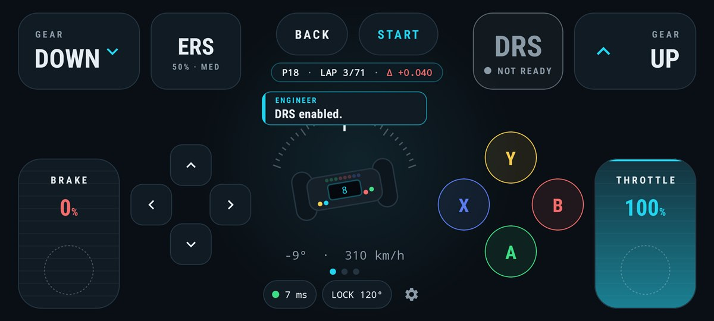
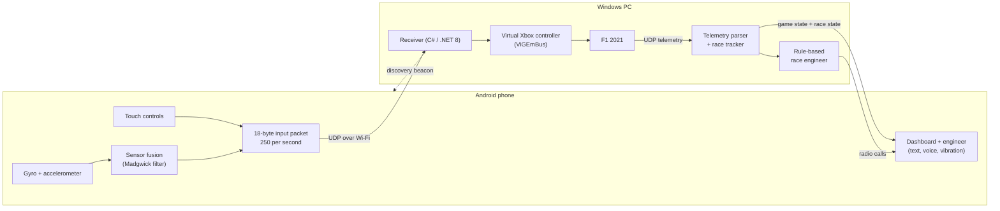

# F1 Phone Controller

**My phone is my F1 rig.** Tilt to steer, thumbs on the pedals, a live dashboard in the middle,
and a race engineer in my ear, all running on an Android phone and talking to F1 2021 on my PC.

  

> This repo is a showcase: what the project does, how it works and what I learned building it.
> The source code is private for now.

---

## Why I built it

I'm a huge F1 fan, and I wanted to feel what sim racing is like without a wheel, pedals and a
cockpit. A gamepad's thumbstick never felt like driving. My phone already has a gyroscope, a
touchscreen and Wi-Fi, so I turned it into the whole rig: the wheel, the pedals, the
dashboard and the radio.

## What it does

| | |
|---|---|
| **Tilt to steer** | The phone's gyroscope and accelerometer become a steering angle, with adjustable lock, deadzone and centre. |
| **Pedals and buttons** | On-screen throttle, brake, gears, DRS, ERS and D-pad. The game sees an ordinary Xbox controller. |
| **Live dashboard** | Gear, rev lights, speed, DRS and ERS, plus swappable *Car* and *Timing* views: position, lap delta, sector times, gaps, tyre wear and temperatures, fuel. |
| **Race engineer** | Radio calls on screen, spoken aloud and as vibration: track limits, purple sectors, yellow flags, overheating tyres, damage, rain on the way, the car behind closing in. |
| **Zero setup** | The app finds the PC on the network by itself and reconnects automatically, even after the hotspot gives the PC a new IP. |

  
  &nbsp;
  

  

## How it works

1. The phone fuses gyroscope and accelerometer readings into a steering angle and sends it
   with the pedal and button state **250 times a second** over UDP.
2. The Windows receiver turns each packet into a virtual Xbox controller report, so F1 2021
   (or any game that supports a controller) just sees a gamepad.
3. The game streams its telemetry back over UDP. The receiver decodes it, tracks the race
   (gaps, sectors, tyres, fuel, flags) and sends a compact summary to the phone ten times a second.
4. A rule-based race engineer watches the same data and decides what is worth saying, and when.

## Technical highlights

**Low-latency input over Wi-Fi.** Steering has to feel instant. Input goes over raw UDP with
a fixed 18-byte packet, no TCP and no serialization library, sent on a dedicated thread with
a fixed-rate schedule. A ping/pong side channel measures the round trip live.
*Result: 250 packets/s, 0% loss, ~3 ms average round trip on 5 GHz Wi-Fi.*

**Chasing jitter down to the hardware.** Steering sometimes felt "slow, then fast". I measured
the packet timing at the receiver and traced the spikes to the laptop's Wi-Fi power
saving, not the code. Turning off packet coalescing and MIMO power save and raising the
receiver's process priority took jitter from **3–5 ms to 0.5–2 ms**, and the packet rate
from a wobbly 241–266/s to a steady 249–253/s.

**Turning a phone into a steering wheel.** Raw gyroscope readings drift, and raw accelerometer
readings are noisy. A Madgwick filter fuses the two into a stable orientation, which is then
mapped to the steering axis with a configurable lock angle, deadzone, centre offset and
smoothing curve.

**Reverse-engineering the game's telemetry.** F1 2021 streams binary UDP packets (car telemetry,
lap data, car status, damage, session, events). The receiver parses them with fixed layouts,
then builds its own state on top. One example: live gaps to the cars ahead and behind are
worked out from each car's distance history, because the game doesn't send gaps.

**A race engineer that knows when to stay quiet.** The hard part isn't generating calls, it's
radio discipline: priorities (critical calls skip the queue), minimum spacing, per-call
cooldowns, dropping news that's gone stale, merging related calls ("Rears are overheating"
instead of three separate calls), and staying silent after the chequered flag. I tuned the rules
against logs from real sessions.

**Surviving the phone's battery manager.** In testing, the phone's power manager froze and then
killed the text-to-speech engine mid-session: the text kept coming but the voice went silent.
The app now notices when speech stalls and reconnects the engine itself, at most once
every 10 seconds, so a broken engine can't put it in a loop.

**Finding the PC by itself.** The phone's hotspot hands the PC a new IP from time to time. The
receiver now broadcasts a small beacon on every network it's on, and the phone follows it,
but only while it has no working link, so a manually entered IP still wins.

**Tested.** 89 automated tests on the receiver and 18 on the phone cover packet formats,
telemetry parsing, every engineer rule and the radio dispatcher.

## Tech stack

| Phone | PC |
|---|---|
| Kotlin, Jetpack Compose | C# / .NET 8 |
| Android sensors, TextToSpeech | ViGEmBus (virtual Xbox 360 controller) |
| UDP sockets, coroutines | F1 2021 UDP telemetry |
| JUnit | xUnit |

## Roadmap

- [x] Gyro steering, touch pedals and buttons, virtual Xbox controller
- [x] Live dashboard with game telemetry (gear, revs, DRS, ERS)
- [x] Car and Timing views: gaps, sectors, lap delta, tyres, fuel, damage
- [x] Rule-based race engineer with voice and vibration
- [x] Automatic PC discovery and speech engine recovery
- [ ] Full race testing and tuning the engineer
- [ ] **An AI race engineer you can talk to**, like real F1 radio ("How are the tyres?", "What's the gap?")
- [ ] Deeper telemetry analysis: braking traces, lap comparisons

## About

Built by [Victor Bashayi](https://github.com/VictorBashayi). Questions or ideas? Open an issue.
